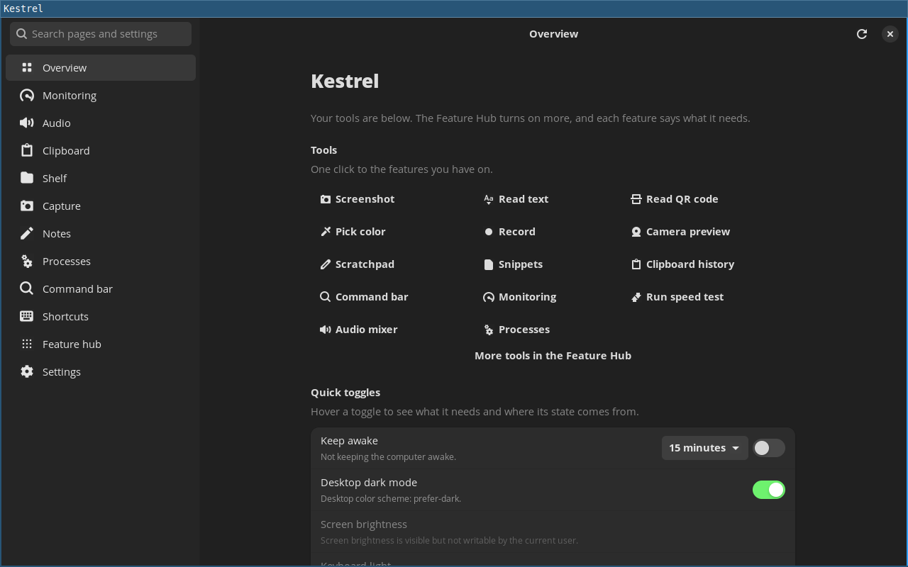

# Kestrel

Kestrel adds the utilities a COSMIC, Sway, or Hyprland desktop leaves out —
clipboard history that pastes back into the application you came from,
screenshots with an editor and OCR, a floating shelf, a command bar, audio
routing, and quiet status readouts — in one window that runs beside your
compositor rather than replacing it.



## What's in it

- [Monitoring and alerts](docs/features.md#monitoring--systemmonitor): CPU, memory, disk, network, temperature, battery, GPU and accessory readings, with sustained alert rules and tray readouts; history stays in memory.
- [Audio mixer](docs/features.md#audio-mixer--audiomixer) and [microphone controls](docs/features.md#microphone-controls--audiomicrophone): per-application volume, output and input priority, mute, and following an output as devices connect.
- [Clipboard history](docs/features.md#clipboard-history--clipboardhistory), [snippets](docs/features.md#snippets--snippetstext) and [scratchpad](docs/features.md#scratchpad--notesscratchpad): memory-only history, snippet insertion through `wtype` or `xdotool`, tabbed notes.
- [Screenshots](docs/features.md#screenshots--capturescreenshot) and [screen tools](docs/features.md#screen-tools--capturetext-captureqr-capturecolor): crop, annotate, redact, OCR, QR codes, colour picking, and pasted images or extra canvas space; recent captures are kept under a limit.
- [Screen recording](docs/features.md#screen-recording--capturerecording): a screen, window or area, with system and microphone audio, saved as VP8 WebM, and trim; the desktop asks each time.
- [Camera preview](docs/features.md#camera-preview--camerapreview): check a webcam before a call, with distinct states for no camera, no permission, and a camera in use; frames stay in memory and the camera stays off until you press Start.
- [Processes](docs/features.md#processes--systemprocesses) and [open ports](docs/features.md#open-ports--networklisteners): find your own processes and end, kill, restart, or stop the owner; see TCP and UDP listeners.
- [Quick toggles](docs/features.md#quick-toggles): desktop dark mode, Keep awake from 15 minutes up to 24 hours, screen brightness, keyboard light, Wi-Fi, Bluetooth, lock screen, eject, Empty Trash, hidden files and desktop icons.
- [Command bar](docs/features.md#command-bar--commandsbar) and [keyboard shortcuts](docs/features.md#keyboard-shortcuts): search the app's actions, with computed answers for arithmetic, units, dates and colours, or bind actions to keys and `kestrel --command`.
- [Status bar overlay](docs/features.md#status-bar-overlay--overlaystatus): recording, alerts, volume and Keep awake in a small pill that appears only while a module has something active.
- [Shelf](docs/features.md#shelf--filesshelf): a floating shelf you can pin open, drag files, text, and links into, and drag back out to another application.
- [Clean links](docs/features.md#clean-links): see each tracking parameter removed from a link before it is copied, or clean a single copied link automatically.

## Status

In preview: an x86_64 AppImage tagged `x.y.z-preview.N` on GitHub Releases,
with a SHA-256 file. GNOME, KDE Plasma, Hyprland, and X11 are supported by
design with little real use so far, so reports are welcome.

**Where it runs**

- **Tested:** Pop!_OS 24.04 with COSMIC on Wayland, and the AppImage in CI on Ubuntu 22.04 under Xvfb and headless Sway.
- **Should run:** glibc 2.35 or newer: Ubuntu 22.04+, Linux Mint 21+, Debian 12+, Fedora 38+, and Arch (untested).
- **Won't start:** systems with glibc older than 2.35, such as Ubuntu 20.04 and Debian 11.

Which features work on each desktop is in the
[compatibility table](docs/compatibility.md). Known limits are listed in
[docs/features.md](docs/features.md#known-limits).

## Install

The AppImage is the current channel. Set `VERSION` to the latest preview on
[GitHub Releases](https://github.com/kamleshkc2002/kestrel/releases), then:

```bash
VERSION="0.6.0-preview.6"
FILE="Kestrel-$VERSION-x86_64.AppImage"
URL="https://github.com/kamleshkc2002/kestrel/releases/download/v$VERSION"
curl -LO "$URL/$FILE"
curl -LO "$URL/$FILE.sha256"
sha256sum -c "$FILE.sha256"
chmod +x "$FILE"
./"$FILE"
```

- **Requires:** a GTK4 desktop session; the app starts without GStreamer. Screen recording is the only feature that uses GStreamer, and the AppImage does not bundle it: install the system's GStreamer 1.x runtime with its PipeWire, Base, and Good plugins (on Debian and Ubuntu: `libgstreamer1.0-0`, `libgstreamer-plugins-base1.0-0`, `gstreamer1.0-pipewire`, `gstreamer1.0-plugins-base`, and `gstreamer1.0-plugins-good`). Without it, recording says what to install and the rest of the app works. See [Screen recording](docs/features.md#screen-recording--capturerecording).
- **Arch Linux:** install `kestrel-desktop` from the AUR, or build [packaging/aur](packaging/aur) with `makepkg`. The package builds the tagged release from source and never installs updates by itself, and its GStreamer optional dependencies cover screen recording.
- **Flatpak:** the 0.9 release also ships a restricted Flatpak build from the releases page; it is not available on Flathub yet.
- If the AppImage does not mount, run it with `--appimage-extract-and-run`. No root is needed.
- To build from source, see [Development](docs/development.md).

## Privacy

- No telemetry, accounts, or crash reporting. The update check is off until you turn it on.
- Nothing contacts a network host without your action, except the sound-server connection, which goes where libpulse is configured to connect, and the update check once you turn it on.
- Clipboard history is memory only; locking the session, sleeping, or quitting wipes it.
- Settings and data stay in your XDG folders, under a `kestrel` folder.
- Settings → Remove Kestrel's data… lists everything Kestrel keeps and removes only what you choose.

Full detail is in [Privacy](docs/privacy.md).

## Documentation

[Features](docs/features.md) · [Compatibility](docs/compatibility.md) ·
[Privacy](docs/privacy.md) · [Configuration](docs/configuration.md) ·
[Stability](docs/stability.md) · [Development](docs/development.md) ·
[Requirements](docs/REQUIREMENTS.md) · [Architecture](docs/ARCHITECTURE.md)

## Feedback

Feedback on the preview is welcome in
[issue #331](https://github.com/kamleshkc2002/kestrel/issues/331); for a bug,
use the [bug report form](https://github.com/kamleshkc2002/kestrel/issues/new?template=bug_report.yml).
To say whether a feature works on your desktop, use the
[compatibility report form](https://github.com/kamleshkc2002/kestrel/issues/new?template=compatibility_report.yml).
Settings → Diagnostic logs → Report a problem opens the bug form with your
version and desktop filled in.

## License

MIT. See [`LICENSE`](LICENSE).
