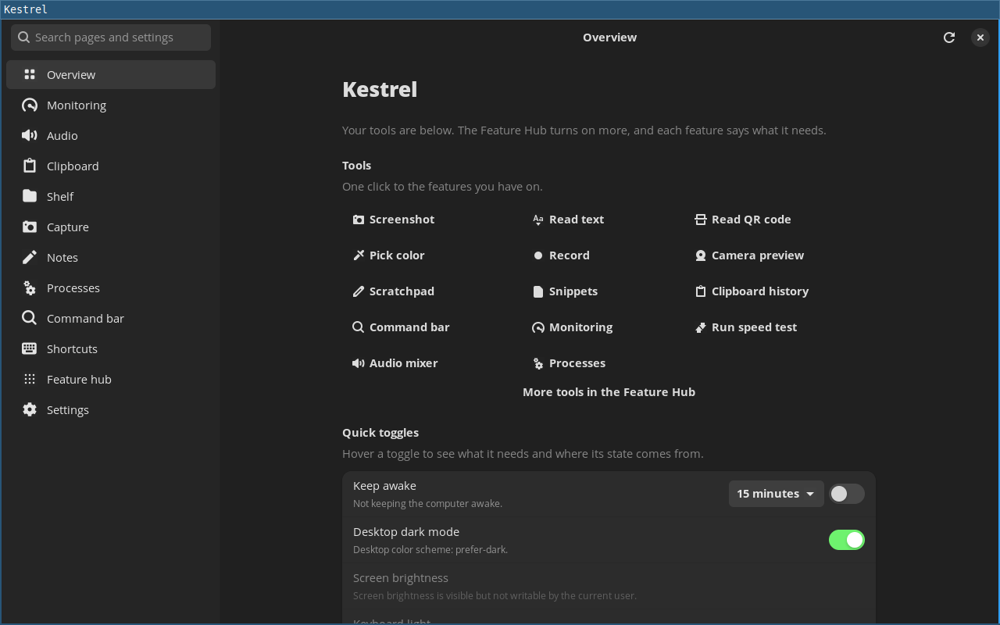
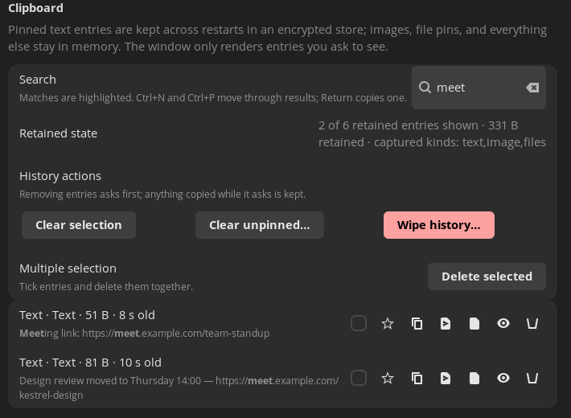
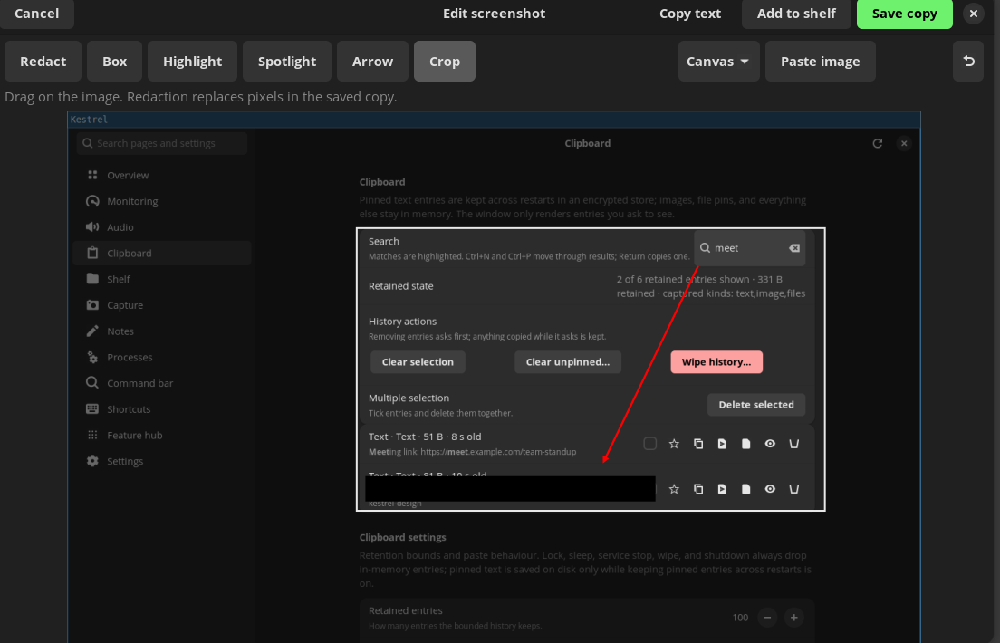
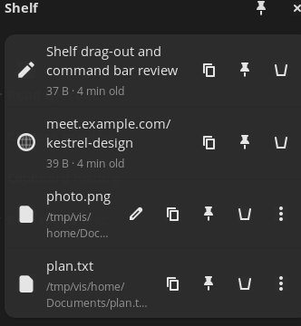
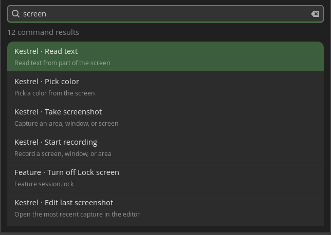
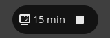

# Kestrel



**Kestrel adds the utilities a COSMIC, Sway, or Hyprland desktop leaves out —
clipboard history that pastes back into the application you came from,
screenshots with an editor and OCR, a floating shelf, a command bar, audio
routing, and quiet status readouts — in one window that runs beside your
compositor rather than replacing it.**

## Why Kestrel on your desktop

**COSMIC.** COSMIC ships a compositor and its own settings, not a
per-application audio mixer, clipboard history that pastes back, or a screenshot
editor with OCR. Kestrel fills those gaps, follows COSMIC's light and dark mode,
and draws its floating surfaces alongside COSMIC's own panels.

**Sway.** A keyboard-first tiling compositor leaves the mixer, clipboard
manager, and screenshot editor to you. Kestrel opens from `kestrel --command`
bindings, captures through `grim` and `slurp` on wlroots, and places its command
bar and status overlay inside your layout as layer-shell surfaces.

**Hyprland.** The same gaps, with extra integration: Kestrel registers
shortcuts through the GlobalShortcuts portal where Hyprland exports it, and its
floating shelf, command bar, and status overlay sit above tiled windows without
taking a tile.

## What you get

- **Clipboard history:** opt-in, memory-only history with search; Shift+Return pastes an entry into the previous application. Opt-in encrypted saved pins are coming in 0.9.
- **Screenshots and screen tools:** capture a screen, window, or area, then crop, draw, redact, or copy its text with on-computer OCR; also read QR codes and pick colours.
- **Shelf:** a floating shelf you can pin open, drag files, text, and links into, and drag back out to another application.
- **Command bar:** a floating search over the app's tools, features, and your scripts, with answers for arithmetic, units, dates, and colours.
- **Audio mixer:** per-application volume, output and input priority, and a port picker on outputs with more than one.
- **Status overlay:** a small pill that appears only while something is active — recording, alerts, volume, microphone, or the Keep awake countdown.
- **Keep awake:** hold off idle and sleep for 15 minutes up to 24 hours, with the time left on Overview and in the tray.
- **Clean links:** see each tracking parameter removed from a link before it is copied, or clean a single copied link automatically.

## Screenshots











## Install

The AppImage is the current channel. Set `VERSION` to the latest preview on
[GitHub Releases](https://github.com/kamleshkc2002/kestrel/releases), then:

```bash
VERSION="0.6.0-preview.6"
FILE="Kestrel-$VERSION-x86_64.AppImage"
URL="https://github.com/kamleshkc2002/kestrel/releases/download/v$VERSION"
curl -LO "$URL/$FILE"
curl -LO "$URL/$FILE.sha256"
sha256sum -c "$FILE.sha256"
chmod +x "$FILE"
./"$FILE"
```

- **Requires:** the system's GStreamer 1.x runtime, which the AppImage does not bundle. On Debian and Ubuntu that is `libgstreamer1.0-0` and `libgstreamer-plugins-base1.0-0`; screen recording also needs the PipeWire, Base, and Good plugins.
- If the AppImage does not mount, run it with `--appimage-extract-and-run`. No root is needed.
- **Arch Linux:** an AUR package is coming; until it is published, use the AppImage or build from source.
- **Flathub:** coming soon.
- To build from source, see [Development](development.md).

## Where it runs

- **Tested:** Pop!_OS 24.04 with COSMIC on Wayland, and Ubuntu 24.04 in CI under Xvfb.
- **Should run:** glibc 2.39+ distributions such as Fedora 40+, Debian 13, and Arch (untested).
- **Won't start:** Ubuntu 22.04, Debian 12, and older.

Which features work on your desktop is in the
[compatibility table](compatibility.md); known limits are in
[Features](features.md#known-limits).

## Privacy

Local-first. There is no telemetry, account, or crash reporting, and the update
check is opt-in; nothing is uploaded. Clipboard history stays in memory and is
wiped when you lock the session, sleep, or quit. Settings and data live in your
XDG folders, and Settings → Remove Kestrel's data… lists every file and removes
only what you choose. Full detail is in [Privacy](privacy.md).

## Documentation

[Features](features.md) · [Compatibility](compatibility.md) ·
[Privacy](privacy.md) · [Configuration](configuration.md) ·
[Stability](stability.md) · [Development](development.md) ·
[Requirements](REQUIREMENTS.md) · [Architecture](ARCHITECTURE.md)

Source, issues, and releases are on
[GitHub](https://github.com/kamleshkc2002/kestrel).

## License

MIT. See [`LICENSE`](https://github.com/kamleshkc2002/kestrel/blob/main/LICENSE).
